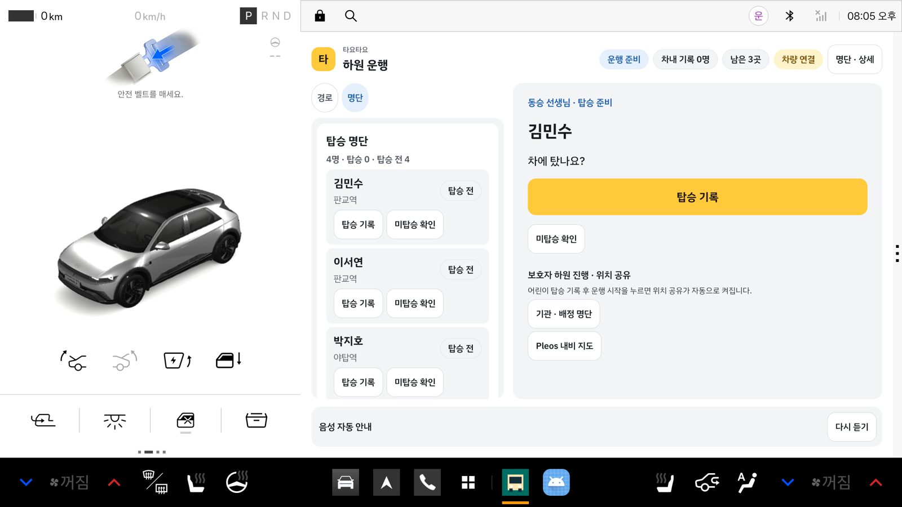
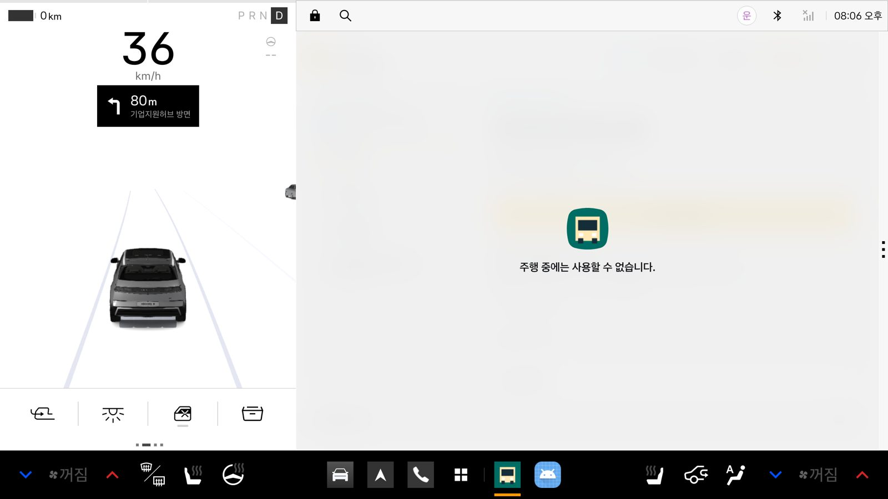
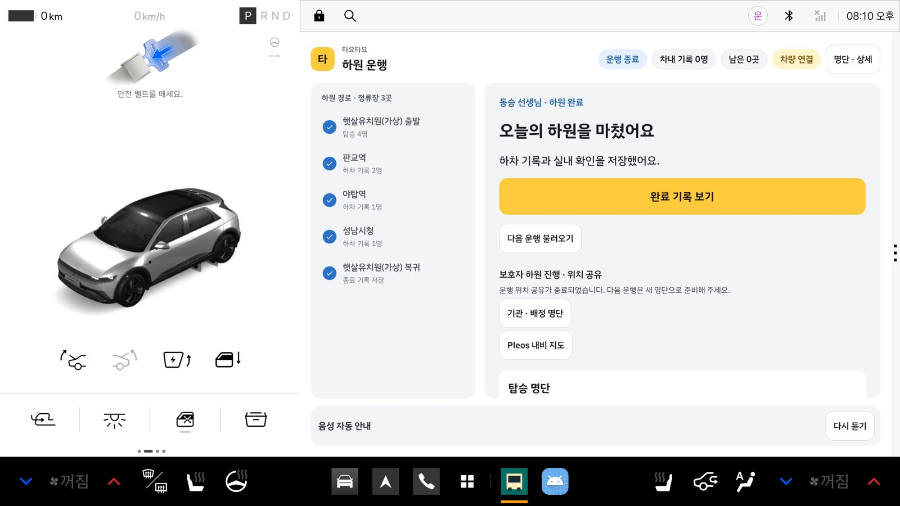
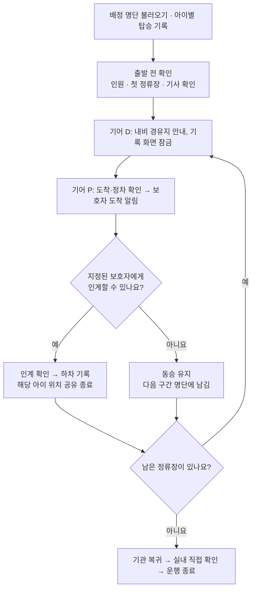

# 타요타요 — 어린이 통학 차량 Pleos 앱

**아이가 차에 타고 내리는 순간을 동승 선생님이 차량 화면에서 확인하고 기록하는 Pleos Connect 앱입니다.**
Pleos 차량의 기어·차속 신호로 주행 중에는 내비만 보여 주고, P로 정차하면 탑승·인계·하차 기록 화면으로 돌아옵니다. 기록은 기관 서버를 거쳐 보호자 앱에 바로 나타납니다.


> 운행을 시작하면 Pleos 내비가 정류장 3곳을 경유지로 안내합니다. 2026-11-15 Pleos Connect 에뮬레이터에서 로컬 서버와 가상 아동 4명으로 진행한 하원 운행 화면입니다.

**[⬇️ 차량 앱 v1.0.0 APK 내려받기](https://github.com/Hyundai-Mobility-Challenge/TayoTayo-vehicle/releases/download/v1.0.0/TayoTayo-1.0.0.apk)** (43.5MB · Pleos Connect, API 28 이상) · [Releases](https://github.com/Hyundai-Mobility-Challenge/TayoTayo-vehicle/releases)

> [!NOTE]
> 릴리스 APK는 **HTTPS 서버에만** 연결됩니다. 내부망 HTTP 서버(`http://10.0.2.2:8080` 등)로 시연할 때는 [빌드](#2-빌드)의 디버그 APK를 사용하세요.

이 저장소는 타요타요의 **대표 저장소**입니다. 차량 앱 소스를 관리하고, 서버와 보호자 앱은 서브모듈로 연결합니다.

| 구성 | 저장소 | 이 저장소 안의 위치 |
| --- | --- | --- |
| **Pleos 차량 앱** | [TayoTayo-vehicle](https://github.com/Hyundai-Mobility-Challenge/TayoTayo-vehicle) | [`app/`](app) |
| 기관 서버 | [TayoTayo-server](https://github.com/Hyundai-Mobility-Challenge/TayoTayo-server) | [`server/`](server) 서브모듈 |
| 보호자 앱 | [TayoTayo-parent](https://github.com/Hyundai-Mobility-Challenge/TayoTayo-parent) | [`parent/`](parent) 서브모듈 |

## 왜 만들었나

어린이 통학 차량에서 가장 중요한 일은 **누가 탔고, 누구에게 넘겨졌는지**를 빠짐없이 확인하는 것입니다. 그런데 이 확인은 지금도 종이 명단과 전화·메신저에 기대는 경우가 많고, 달리는 차 안에서 휴대폰을 꺼내 확인하기도 어렵습니다.

타요타요는 센서가 대신 판단하는 서비스가 아닙니다. **사람이 확인해야 할 순간을 차량 화면이 놓치지 않게 짚어 주고, 그 확인을 기록으로 남깁니다.** 차량 신호는 화면 전환과 안내에만 쓰고, 아이의 상태는 선생님이 직접 누른 기록으로만 바뀝니다.

## 하원 운행 한 바퀴

| 1. 배정 명단 불러오기 | 2. 출발 전 확인 |
| :---: | :---: |
|  |  |
| 기관이 배정한 오늘의 명단을 불러와 아이마다 **탑승 기록**을 남깁니다. | 방문 순서와 탑승 인원을 기사와 함께 확인하고, 음성으로도 요약을 듣습니다. |
| **3. 주행 중 화면 잠금** | **4. 정차 후 대면 인계** |
|  |  |
| 기어 D에서는 Pleos가 앱 입력을 막고 길 안내만 남깁니다. | P로 정차하면 기록 화면으로 돌아옵니다. 보호자가 없으면 **동승 유지**를 선택합니다. |
| **5. 복귀 후 실내 확인** | **6. 운행 종료** |
|  |  |
| 차 안에 남은 기록이 0명이어도 선생님이 실내를 직접 확인한 뒤 종료합니다. | 탑승·인계·하차·실내 확인 기록이 서버에 저장되고 위치 공유가 끝납니다. |

같은 운행을 보호자는 [보호자 앱](https://github.com/Hyundai-Mobility-Challenge/TayoTayo-parent)에서 **운행 중 → 정류장 도착 → 인계·하차 완료** 순서로 확인합니다.



## Pleos SDK를 어디에 쓰나

| SDK | 쓰는 정보 | 앱에서 하는 일 |
| --- | --- | --- |
| Vehicle 2.3.2 | 기어, 차속, 주행 중 화면 제한 | D에서는 기록 화면을 잠그고 내비를 앞에 띄웁니다. P 정차가 확인되면 도착·인계 기록 화면으로 돌아옵니다. |
| Vehicle 2.3.2 | 안전띠 경고, 도어 잠금 | 출발 전과 재출발 때 안전띠 재확인을 요청합니다. 아이별 착용 여부는 선생님이 확인합니다. |
| NaviHelper 3.0.5 | 경유지 경로 요청, 남은 거리·시간 | 정류장을 순서대로 경유지로 등록하고, 한 곳을 마치면 남은 정류장으로 경로를 다시 요청합니다. 남은 시간은 서버로 보내 보호자 앱의 예상 도착 시간이 됩니다. |
| TextToSpeech 3.3.1 | 한국어 음성 안내 | 출발 전 요약, 다음 정류장과 내릴 아이, 도착 후 인계 안내, 복귀 후 실내 확인을 읽어 줍니다. |

## 설계에서 지킨 원칙

**차량 신호는 화면만 바꾸고, 기록은 사람이 남깁니다.** 내비 도착 이벤트나 남은 거리 0m, 정류장 근처 위치만으로 도착·하차를 처리하지 않습니다. 운행 기록은 차량 연결, 최신 차속 0, 기어 P가 모두 확인될 때만 받습니다. 하나라도 빠지면 이유를 화면에 보여 주고 기록을 막습니다(`ShuttleEngine.stationaryBlockers`).

**통신이 끊겨도 기록을 잃지 않습니다.** 모든 기록은 기기에 먼저 저장한 뒤 서버로 보냅니다. 이벤트마다 운행 번호와 기록 키로 만든 고정 식별자(`clientEventId`)를 붙여서, 다시 연결돼 재전송해도 서버에는 한 건만 남습니다. 미전송 이벤트가 여러 건이면 묶음(`/events/batch`)으로 보냅니다(`InstitutionConnection`).

**보호자를 만나지 못한 아이는 하차 처리하지 않습니다.** 동승 유지를 선택하면 아이는 다음 구간 명단에 남고, 기관에 복귀해 담당자에게 인계할 때까지 추적됩니다.

## 시작하기

### 1. 전체 소스 받기

```sh
git clone --recurse-submodules https://github.com/Hyundai-Mobility-Challenge/TayoTayo-vehicle.git
```

이미 받았다면 `git submodule update --init --recursive`를 실행합니다. GitHub의 **Download ZIP**에는 서브모듈 소스가 들어 있지 않습니다. 서버·보호자 앱의 소스 수정은 각 저장소에서 관리합니다.

### 2. 빌드

Android Studio에서 저장소 루트를 엽니다. Android SDK 35, JDK 17 이상, Pleos Maven 저장소 접근이 필요하고 최소 API는 28입니다. 실행 대상은 Pleos Connect 에뮬레이터입니다.

```sh
./gradlew :app:assembleDebug :app:testDebugUnitTest      # Windows: .\gradlew.bat
```

| 항목 | 값 |
| --- | --- |
| 앱 모듈 / 앱 ID | `app` / `com.hanhyo.pleosshuttle` |
| 디버그 APK | `app/build/outputs/apk/debug/app-debug.apk` |
| Firebase 설정 | 차량 앱에는 필요 없음 (알림은 서버가 보냄) |

### 3. 서버에 연결하고 운행하기

1. [서버 README](https://github.com/Hyundai-Mobility-Challenge/TayoTayo-server)대로 서버를 실행하고 기관·차량·정류장·노선·원아 배정을 준비합니다.
2. 차량 앱 **기관 연결** 탭에 서버 주소와 관리자 웹에서 발급한 **차량 연결 코드**(10분 유효)를 입력합니다.

   | 실행 환경 | 서버 주소 |
   | --- | --- |
   | Pleos 에뮬레이터 (서버와 같은 PC) | `http://10.0.2.2:8080` |
   | 실제 차량 기기 | `http://<서버 PC의 LAN IPv4>:8080` |

3. 관리자 웹이나 API로 **오늘 날짜의 운행**을 만듭니다. 차량 앱은 운행이나 명단을 직접 만들지 않습니다.
4. 등원·하원 방향을 고르고 **배정 명단으로 운행 준비 → 탑승 기록 → 이 순서로 · 운행 시작**을 누릅니다.
5. 정차할 때마다 **도착·정차 확인 → 인계 확인 → 하차 기록**, 복귀하면 **복귀·정차 확인 → 실내 확인 완료 · 운행 종료**를 누릅니다.

보호자 앱 연결에는 차량 연결 코드와 다른 **어린이 초대 코드**가 필요합니다. 세 앱을 함께 연결하는 순서는 [전체 연결 안내](docs/INTEGRATION.md)와 [시연 순서](docs/DEMO_STEP_BY_STEP.md)에 있습니다.

## 구조

```text
app/src/main/java/com/hanhyo/pleosshuttle/
├─ domain/   운행 상태 엔진(ShuttleEngine), 승하차·인계 규칙, 출발 전 확인, 경로 순서
├─ sdk/      Pleos Vehicle·NaviHelper 어댑터
├─ audio/    TextToSpeech 안내와 발화 순서 제어
├─ ui/       Compose 화면 (명단, 운행, 인계, 기관 연결)
└─ *.kt      서버 연동(InstitutionConnection), 주행 중 화면 전환, 위치·ETA 전송
```

| 경로 | 내용 |
| --- | --- |
| `common/kotlin/` | 서버 API 클라이언트 사본 |
| `docs/` | 설계·연동·시연 문서 |
| `scripts/` | Pleos SDK·오디오 검증 도구 |

## 검증과 한계

- `app/src/test`에는 운행 엔진, 주행 중 화면 정책, ETA 전송, 서버 연동 이벤트 등 단위 테스트가, `app/src/androidTest`에는 Pleos 에뮬레이터에서 도는 운행 흐름 기기 테스트가 있습니다.
- 위 화면은 Pleos 에뮬레이터와 Virtual Console로 기어·속도를 바꿔 가며 찍었습니다. 에뮬레이터의 GPS 위치는 내비 지도 위에서 움직이지 않으므로, 실제 도로 주행에서 남은 거리가 줄어드는 동작은 실차 확인이 필요합니다.
- 안전띠는 차량 전체 경고를 재확인 요청에 쓰며, 좌석별 착용 판정은 하지 않습니다. 앱의 기록 완료가 차량 출발 허가나 자동 인계 판정을 뜻하지 않습니다.

[분리 기준](docs/SOURCE_SNAPSHOT.md) · [분리 검증 결과](docs/SPLIT_VALIDATION.md) · [실시간 공유 설계](docs/LIVE_TRACKING.md)
