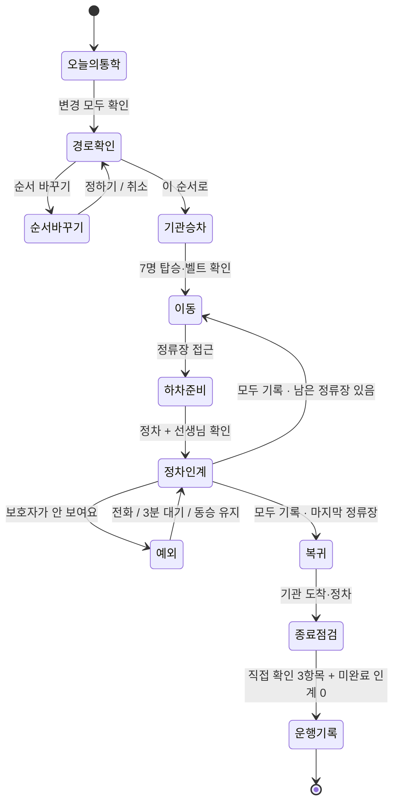
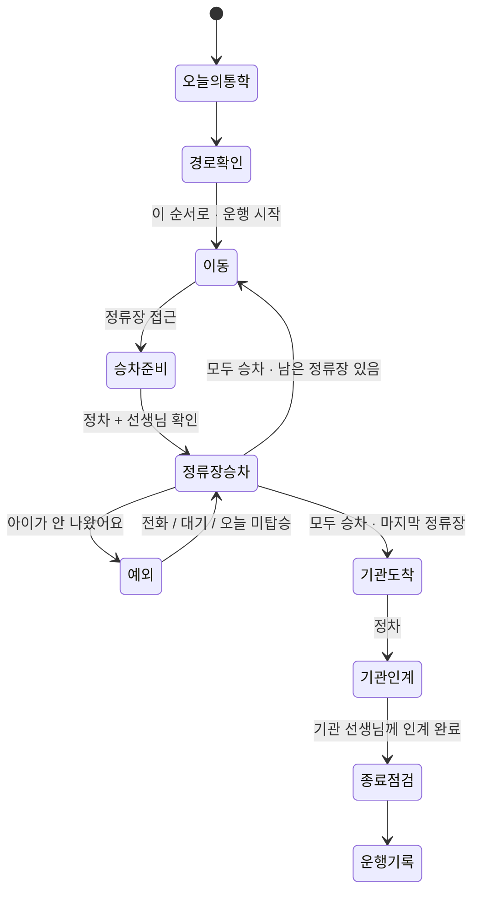

# 흐름과 규칙

## 하원

## 등원

등원과 하원의 차이:

| | 등원 (집 → 기관) | 하원 (기관 → 집) |
|---|---|---|
| 승차 | 정류장마다 보호자에게 인계받고 승차·벨트 기록 | 기관에서 한 명씩 승차·벨트 기록 |
| 정류장 행동 | 인계받기 → 승차·벨트 확인 | 인계 확인 → 하차 기록 |
| 예외 | 아이가 안 나옴 → 전화 / 대기 / 오늘 미탑승 | 보호자 미도착 → 전화 / 대기 / 동승 유지 |
| 끝 | 기관 선생님께 한 번에 인계 → 종료 점검 | 기관 복귀 → 종료 점검 |

## 기존 엔진 단계와의 대응

`ShuttleEngine`의 `TripPhase`에 화면을 맞추는 제안이다. 하차 준비는 `DRIVING` 안의 UI 하위 상태로 둔다.

| TripPhase | 화면 |
|---|---|
| `PREPARING` | 오늘의 통학, 경로 확인, 순서 바꾸기, 기관 승차 |
| `DRIVING` | 이동, 하차(승차) 준비 |
| `ALIGHTING` | 정차·인계, 정류장 승차, 예외, 아이 상세 |
| `END_REVIEW` | 기관 인계(등원), 종료 점검 |
| `ENDED` | 운행 기록 |

등원은 현재 엔진에 없다. 운행 방향(등원/하원)을 상태에 추가하고 정류장 행동을 방향에 따라 바꾸는 방식을 제안한다.

## 주행 중 잠금

| 상태 | 허용 | 막음 |
|---|---|---|
| 주행 중 (속도 > 0 또는 기어 P 아님) | 보기, 안내 다시 듣기, 음악 재생·일시정지·다음 곡 | 인계·승하차 기록, 순서 바꾸기, 동요 목록 열기, 예외 처리 |
| 정차 중 | 위 전부 + 기록, 예외, 동요 목록 | — |
| 차량 정보 미확인 | 보기 | 기록 (기존 PoC 원칙 유지) |

인계·하차 기록은 차량 정차 신호와 선생님의 문 쪽 직접 확인이 모두 있어야 열린다. 센서나 기록으로 안전·하차 완료를 자동 확정하지 않는다.

## 상황별 동요

| 운행 단계 | 음악 | 비고 |
|---|---|---|
| 운행 전 | 대기 (미리 듣기만) | `운행을 시작하면 재생`이 켜져 있으면 출발 시 재생 |
| 이동 | 재생 | 선생님이 언제든 멈춤 |
| 하차 준비 | 설정 음량(끄기/30%/50%)으로 줄이고 안내 음성 먼저 | 차량 경고·내비 안내가 항상 우선(오디오 포커스) |
| 정차·인계·예외 | 일시정지 (항상, 끌 수 없음) | |
| 다시 출발 | `출발하면 이어서 재생`이 켜져 있으면 이어서 재생 | 꺼져 있으면 선생님이 직접 재생 |
| 종료 점검·기록 | 정지 | |

`이번 주 노래를 먼저`가 켜져 있으면 운행 시작 때 이번 주 노래를 한 번 틀고 선택한 목록으로 넘어간다.

## 순서 바꾸기 계산

`code-drafts/domain/RouteTimeline.kt`와 프로토타입이 같은 규칙을 쓴다.

- 도착 시각 = 출발 시각 + 이전 구간 이동 시간 누적 + 앞 정류장 정차 시간(시안 3분) 누적
- 복귀(도착) 시각 = 마지막 정류장 도착 + 정차 + 기관까지 이동
- 경고(시안 예시): 정류장의 가장 이른 도착 허용 시각보다 일찍 도착 · 허용되지 않은 직전 지점에서 진입(길 건너 하차 가능) · 기관 도착 마감 초과
- 이동 시간은 현재 PoC처럼 합성 값이다. 실제 도로 시간 공급원은 미정
- 순서를 정하면 기존 `ShuttleEngine.previewRoute`/`applyRoute`로 반영하고, 내비에는 지금처럼 다음 정류장 하나씩 넘긴다

시안 예시 값(하원, 15:30 출발, 정차 3분):

| 순서 | 도착 | 복귀 |
|---|---|---|
| 제안: 푸른마을 → 새싹도서관 → 별빛초 → 하늘공원 | 15:42 · 15:51 · 15:58 · 16:06 | 16:18 (48분) |
| 하늘공원을 2번째로: 푸른마을 → 하늘공원 → 새싹도서관 → 별빛초 | 15:42 · 15:56 · 16:07 · 16:14 | 16:25 (55분), 하늘공원 약속 16:00보다 4분 이름 |
